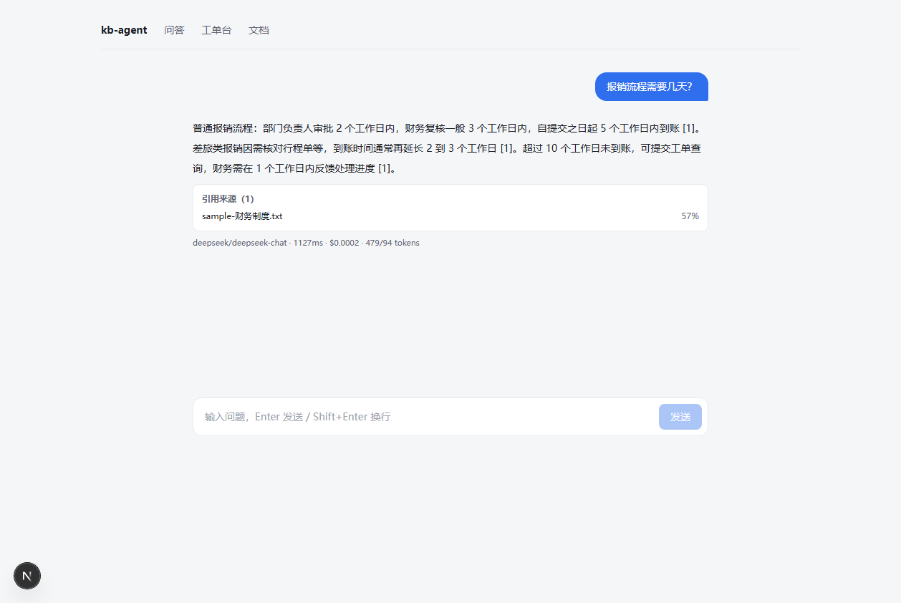
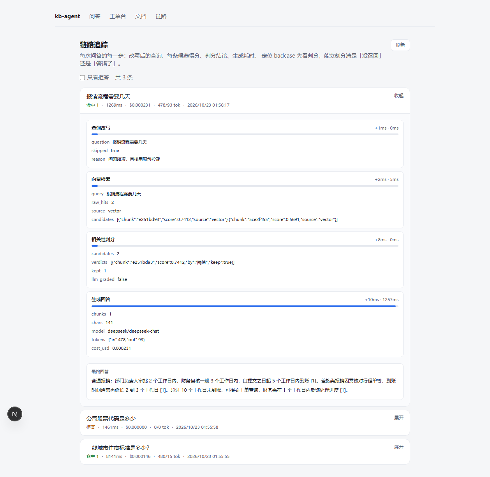

# kb-agent

**把 LLM 接进真实系统的完整实现**：内部文档问答 + 工单自动分流，前后端全栈，本地零依赖可跑。

不是「调 API 的 demo」——重点解决接进真实业务之后的四个问题：**检索不准时怎么不瞎编、成本怎么控、效果怎么评、出了问题怎么定位**。



| 评测集 | 单次成本 | 平均延迟 | 依赖 |
|---|---|---|---|
| 5/5（含 2 条防幻觉用例） | $0.0002 | 430ms | 无需 Docker / 无需 embedding key |

---

## 它解决什么问题

内部文档散在共享盘和邮件里，找人问比搜索快，但人会请假。这个项目做两件事：

1. **知识库问答** —— 文档解析 → 切片 → 向量化 → 检索 → 流式生成，每条回答标注引用来源
2. **工单自动分流** —— 输出严格 JSON（分类 / 优先级 / 置信度），低置信度自动转人工

两个场景**共用同一套模型网关和可观测设施**。这才是「接入真实系统」的含义：模型只是其中一个环节，真正的工程量在它周围。

## 30 秒跑起来

```bash
cp .env.example .env      # 不填 key 也能跑，会自动进 mock 模式
bash scripts/dev.sh       # 后端 :8000  ·  前端 :3000
```

不需要 Docker，不需要 embedding key：向量库跑 Qdrant 嵌入式模式（数据在 `.qdrant/`），
embedding 用本地 ONNX 模型（`bge-small-zh-v1.5`，512 维，首次自动下载约 90MB）。

要接真实模型，在 `.env` 里填 `DEEPSEEK_API_KEY=sk-...` 即可，`LLM_MODE=auto` 会自动切成 live。

## 怎么用

### 换成你自己的文档

1. 打开 <http://localhost:3000/documents>
2. 点选或拖入文件（支持 `.pdf` `.docx` `.md` `.txt` `.html`，单文件 20MB 以内）
3. 等状态从「解析中」变「已索引」——两页的文档约 3 秒
4. 去问答页提问

解析是后台任务，**上传后可以关掉页面**，回来再刷新就能看到结果。

### 提问

- `Enter` 发送，`Shift+Enter` 换行
- 回答下方是引用卡片：文档名 + 页码 + 匹配度
- 生成过程中点「停止」可中断，**已输出的内容会保留**

### 看它为什么这么答

打开 <http://localhost:3000/traces>，展开任意一条，能看到四个步骤：

| 步骤 | 看什么 |
|---|---|
| 查询改写 | 是否跳过了改写（短问题会跳过以省一次调用） |
| 向量检索 | 召回了几条、每条相似度多少 |
| 相关性判分 | 每条候选是被阈值放行、被 LLM 判无关、还是低于下限 |
| 生成回答 | 模型、token、成本、耗时 |

**这是定位问题的入口**：候选被挡掉 = 召回问题；保留了但答歪 = 生成问题。

### 工单分流

打开 <http://localhost:3000/tickets>，填标题和正文，提交后会立刻返回：

- 分类（billing / account / bug / feature / other）
- 优先级（p0~p3）
- 置信度——**低于 0.7 自动标「待人工」**
- 下拉框可人工纠正，纠正记录会留库

### 三种结果长什么样

| 情况 | 表现 |
|---|---|
| 命中 | 流式回答 + 引用卡片 |
| 拒答 | 明确说「知识库中没有找到相关内容」，**这一步不调用模型** |
| 出错 | 保留已输出内容，给出可重试提示 |

## 架构

```
浏览器 (Next.js)
   │  POST /api/chat  (SSE)
   ▼
Next.js BFF (app/api/chat/route.ts)   ← 转发 + 鉴权，密钥不出服务端
   │  内网 HTTP
   ▼
FastAPI (backend/app)
   ├── api/       薄路由：参数校验 + 响应组装
   ├── services/  厚业务：ingest / rag / graph / classify
   └── core/      llm 网关（litellm）· tracing · config
   │
   ▼
SQLite/Postgres(业务表 + trace) · Qdrant(向量，local 模式)
```

## 四个关键设计

| 设计 | 为什么 | 依据 |
|---|---|---|
| **无召回不调模型** | 密集检索永远会返回 top-k，宁可说"找不到"也不给一个看起来合理的编造答案 | [ADR-004](docs/decisions.md) |
| **三段式判分** | 实测真问题 0.50~0.74、不相关问题 0.41~0.47，单阈值切不干净；中间地带交 LLM 判一次 | [ADR-011](docs/decisions.md) |
| **模型调用收敛到网关** | 换模型、控成本、查问题时，调用散落在 20 个文件里就什么都做不了 | [ADR-001](docs/decisions.md) |
| **自建轻量 trace** | 要的粒度是"每个候选为什么被丢"，Langfuse 默认视图不直接给，且它需要一整套服务端 | [ADR-013](docs/decisions.md) |

完整 13 条取舍记录见 [`docs/decisions.md`](docs/decisions.md)。

## 实测数据

**向量检索与判分**（本地 embedding，真实语料）

| 问题 | 相似度 | 判定方式 | 结果 |
|---|---|---|---|
| 报销流程需要几天 | 0.7412 | 阈值直判 | 命中 |
| 出差住酒店能报多少钱（换问法） | 0.6384 | 阈值直判 | **命中**（关键词召回会失败） |
| 一线城市住宿标准是多少？ | 0.4828 | LLM 判分 | 命中 |
| 公司股票代码是多少 | 0.4657 | LLM 判分 | **拒答** |
| 怎么申请专利 | 0.4053 | LLM 判分 | **拒答** |

注意第三、四行的分数几乎一样——这就是为什么需要 LLM 判分，而不是一个阈值。

**真实模型调用**（DeepSeek）

| 指标 | 数值 |
|---|---|
| 首字延迟 | 约 1.1s（含检索） |
| 单次成本 | **$0.000205**（in 479 / out 69 tokens） |
| 累计 35 次问答 | $0.0026 |
| 评测集 | 5/5，`test_no_hallucination_on_unknown` PASSED |

回答内容（真实输出）：

> 普通报销流程：部门负责人审批 2 个工作日内，财务复核一般 3 个工作日内，自提交之日起 5 个工作日内到账 [1]。差旅类报销因需核对行程单等，到账时间通常再延长 2 到 3 个工作日 [1]。

**工单分流**

| 工单 | 结果 | 转人工 |
|---|---|---|
| 发票抬头写错要重开 | billing / p1 / 0.90 | 否 |
| 被重复扣费 199 元 | billing / p1 / 0.95 | 否 |
| 说不上来，就是感觉不太对 | other / p3 / 0.25 | **是** |
| 全员无法登录，业务全停 | account / p0 / 0.60 | **是**（判法待校准，见 ADR-010） |

**链路追踪**（`/traces` 页面可直接看）

```
报销流程需要几天                    命中 1 · 1269ms · $0.000231 · 478/93 tok
├─ 查询改写      +1ms    0ms    skipped=true（问题较短，直接用原句）
├─ 向量检索      +2ms    5ms    raw_hits=2, candidates=[0.7412, 0.5691]
├─ 相关性判分    +8ms    0ms    verdicts=[{score:0.7412, by:"阈值", keep:true}]
└─ 生成回答     +10ms 1257ms    model=deepseek, tokens={in:478,out:93}
```

**这就是定位 badcase 的入口**：看 `grade.verdicts`，被阈值挡掉是召回问题，保留了但答歪是生成问题。



## 目录

| 路径 | 作用 |
|---|---|
| `backend/app/core/llm.py` | **所有模型调用的唯一入口**：档位路由、超时、fallback、记账、mock |
| `backend/app/core/tracing.py` | 轻量链路追踪，每步落 `traces`/`spans`，接口对齐 OTel span 语义 |
| `backend/app/services/graph.py` | **LangGraph 编排**：rewrite → retrieve → grade → generate / fallback |
| `backend/app/services/ingest.py` | 解析 → 切片 → 向量化。切片策略是效果好坏的第一决定因素 |
| `backend/app/services/rag.py` | 检索：向量召回 + 关键词召回（降级 / 混合） |
| `backend/app/services/classify.py` | instructor 结构化分流，低置信度转人工 |
| `frontend/app/api/chat/route.ts` | BFF，把后端 SSE 透传给浏览器 |
| `scripts/dev.sh` | 一键启动（幂等，已运行的服务会跳过） |

## 文档

| 文件 | 内容 |
|---|---|
| [`docs/spec.html`](docs/spec.html) | 工程规格：选型理由、DB 设计、API 契约、4 周可勾选验收清单 |
| [`docs/decisions.md`](docs/decisions.md) | **13 条 ADR**：每个选型的取舍、踩过的坑、代价 |
| [`docs/interview-kit.html`](docs/interview-kit.html) | 面试材料：简历 bullet 三版、数字出处、60 秒演示脚本、高频追问 |
| [`docs/sample-财务制度.txt`](docs/sample-财务制度.txt) | 测试语料，可直接上传 |

## 已知边界

诚实比完美重要，这些都没做：

- **评测集只有 5 条**，是冒烟集不是基准。真正有意义的评测要 50 条以上
- **`next build` 未在本机验证通过**：环境问题（`<distDir>/trace` 并发写被拒），非代码问题，`tsc --noEmit` 零错误。生产包建议在 Linux / CI 出
- **Qdrant 只用过 local 嵌入式模式**，server 模式未验证
- **没有并发压测**，单机项目，不要问 QPS
- **没有鉴权**，单用户场景

## 环境坑（本机实测，可能救你几个小时）

1. **Windows 上 curl 访问 localhost 会被系统代理拦截**，报 `upstream connect failed` / `502`。必须 `curl --noproxy '*'`
2. **pip 默认源很慢**（8 分钟没装完），用 `-i https://pypi.tuna.tsinghua.edu.cn/simple`
3. **npm 同理**，用 `--registry=https://registry.npmmirror.com`
4. **前端调 `/api/v1/*` 会 404**：请求打到了 Next 自己的 3000 端口，需要 rewrite 转发；流式的 `/api/chat` 单独由 route handler 处理（保留 SSE 语义）
5. **`next dev` 启动时清理 `.next` 可能被拦**：用 `NEXT_DIST_DIR=.next-dev npm run dev` 换目录绕过
6. **litellm 首次调用卡 50 秒**：它要去 GitHub 拉价格表。在 `import litellm` 之前设 `LITELLM_LOCAL_MODEL_COST_MAP=True`
7. **litellm 非流式路径会 import `mcp`**：不装的话**流式问答正常、工单分流全挂**（instructor 走非流式），非常隐蔽
8. **Windows 上 fastembed 下模型会失败**：文件在 `blobs/` 但快照目录为空，是符号链接权限问题。可手动按 `trees/<hash>.json` 复制，或设 `HF_ENDPOINT=https://hf-mirror.com`
9. **`next build` 报 `EPERM ... <distDir>/trace`**：多 worker 并发追加同一文件被系统拒绝。排查过路径空格 / `NODE_OPTIONS` / dev 占用，均不是

## 不要做的事

- 不要在业务代码里直接 `openai.chat.completions.create`（用 `core/llm.py`）
- 不要同步解析大文件（用 BackgroundTasks + 状态轮询）
- 不要用 prompt 约束 JSON 格式（用 instructor + schema 校验）
- 不要跳过评测集（没有数字的项目在面试里等于没做）
